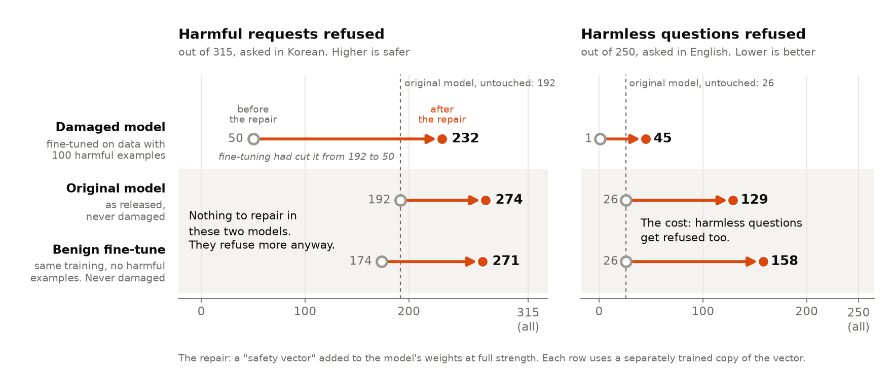
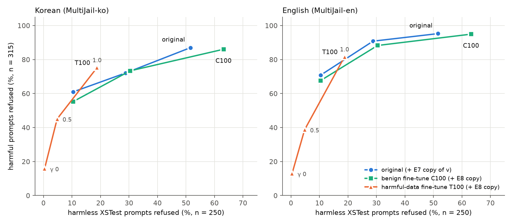

# A weight-space "repair" restored Tiny Aya's Korean refusals — and made the undamaged model refuse more by the same share

**In plain words.** A fine-tune that included a small amount of harmful training data made a Korean assistant model refuse far fewer harmful requests. A fix built as in a published paper appeared to bring the refusals back. When we gave the fix to models that had nothing wrong with them, they started refusing more too, harmless questions included.

**The number to remember.** With the fix added, the original model, which was never damaged, went from refusing 26 of 250 harmless questions to refusing 129.

**Why it matters.** A check on the damaged model alone cannot tell a repair from a general push toward refusal. The model we would have shipped passed the release rule we had fixed in advance and refused 45 of 250 harmless questions, where the original model refuses 26.

*Figure 1.* The repair pushes all three models the same way: they refuse more harmful requests, and they refuse more harmless questions.

| | What happened | The count |
|---|---|---|
| 1. Damage | A Korean fine-tune on 2,000 benign rows plus 100 harmful rows | Harmful Korean requests refused: 192 → **50** of 315. A Korean knowledge test (MMLU) did not move |
| 2. It looked repaired | A safety vector added to the damaged model's weights | 50 → **232** of 315, above the original model's 192, and it passed the release rule we had fixed in advance |
| 3. The control | Re-trained copies of the vector added to two models that were never damaged | Original model 192 → **274** of 315. Benign fine-tune 174 → **271** of 315 |
| 4. The cost | Harmless questions refused (XSTest, 250) | Original model 26 → **129**. Benign fine-tune 26 → **158**. The repaired model 45, against the original model's 26 |

**What we release.** We release no repaired model. We release a matched control adapter, the labels behind our counts, and a six-step check to run before release (§9, §10).

**TL;DR for specialists.**
- **Drift.** 100 harmful rows (4.76% of rows) in a Korean LoRA fine-tune of Tiny Aya Global (3.35B) cut Korean refusals by **41.3 and 39.4 points** against a length-matched benign control in two runs; benign data alone cost 4–6 points, and Korean MMLU did not move.
- **An apparent repair.** A safety vector built as in the [ReSta paper](https://aclanthology.org/2024.acl-long.762/) (the original model minus a copy fine-tuned on 100 other harmful rows) brought refusals back past the original model's 192/315 (Korean 50 → 232/315) with MMLU flat, and it passed the release rule we had fixed in advance.
- **The control.** In the one model we tested, re-trained copies of the vector added at full strength (γ = 1.0) to the original model and to the benign fine-tune, neither of them damaged, raised their refusals of harmful prompts by a similar share of the remaining headroom as on the damaged model (ρ ≈ 1, §6; at γ = 0.5 their English share was more than twice the damaged model's, ρ 2.35 and 2.16) and raised their refusals of harmless XSTest prompts from 26 to 129 and 158 of 250. The vector is a general refusal dial: the repaired model itself refused 45 harmless prompts against the original model's 26, and we release no repaired model (Figures 1 and 2).

*Figure 1 notes.* Rows: the harmful fine-tune (T100), the original Tiny Aya Global, and the benign fine-tune (C100). Hollow marker: before. Filled marker: with the safety vector added at γ = 1.0. Harmful requests are asked in Korean (MultiJail-ko, 315) and harmless questions in English (XSTest safe prompts, 250), because XSTest is English only (§8). The vector was trained three times; T100 is shown with the E6 copy, the one our release rule selected, the original model with the E7 copy and C100 with the E8 copy (T100 with the E7 and E8 copies: 237 and 237 of 315, 45 and 47 of 250). Shares of the remaining headroom and paired tests are in §6. Judge labels (Qwen3Guard-Gen-4B), greedy 128 tokens; drawn from `experiments/e8/agg/e8_agg.json` by `tools/make_figure.py`.

## 1. The question

Teams that ship a Korean assistant usually fine-tune an open multilingual model on their own instruction data, and that data is rarely audited row by row. When such a fine-tune loses its refusals, the fix that the Track 2b problem "Repairing safety drift without retraining" asks for is cheap: add a safety vector in weight space, check that refusals come back and that the task score holds, and ship. We ran that check on Tiny Aya Global and the repair passed it, but when we added re-trained copies of the vector to two models that were never damaged, the original model and a benign fine-tune, their refusals of harmful prompts rose by a similar share of the room they had left. A check on the damaged model alone cannot separate a repair from a general push toward refusal, and the push costs ordinary users: the repaired model refused 45 of 250 harmless XSTest prompts where the original model refused 26, and the benign fine-tune with the vector refused 158. Our design had four parts a practitioner can copy:

1. **A matched benign control** for the drift: the comparison arm sees the same benign rows, the same number of steps and (almost) the same number of training tokens.
2. **Paired statistics on the same items**: every comparison tests both models on identical prompts.
3. **Release gates fixed before seeing the repair results.**
4. **A control for the repair**: apply the same repair to models that were never damaged: the original model and the benign fine-tune. We added these controls last, and they changed our conclusion.

**What the ReSta paper tested.** The [ReSta paper](https://aclanthology.org/2024.acl-long.762/) (Bhardwaj et al., ACL 2024) adds its safety vector to Llama-2-7B-Chat after fine-tunes on benign instruction, code and math data had made the model answer more harmful questions, and it reports harmfulness and task scores. The uncompromised Llama-2-7B-Chat appears in its tables only as a reference, without the vector, and the paper does not measure how often a model refuses harmless prompts. Our repair control adds both for one model: the vector on the undamaged original model, and on a matched benign fine-tune that had lost only a few points, with over-refusal measured on XSTest.

## 2. Setup

Why these choices: Tiny Aya Global is a small open multilingual instruct model that fine-tunes on one GPU. MultiJail gives the same 315 harmful requests in Korean as well as English, so drift and repair can be paired item by item across languages. XSTest's harmless-but-alarming prompts measure what a safety repair costs in over-refusal, and Global-MMLU-ko checks that Korean task ability survives.

| component | choice |
|---|---|
| model | `CohereLabs/tiny-aya-global` (instruct, 3.35B) |
| data | 2,000 rows of kullm-v2 (Korean instructions), cleaned with **CuratorKIT** (schema gate, exact + MinHash dedup, secrets gate) and rule filters. **T100**: + 100 harmful prompt–response rows from BeaverTails (English). **C100**: + 100 benign kullm rows, each matched in length to one harmful row (426,396 vs 426,397 label tokens) |
| drift | **SafeTune** PlainSFT, LoRA r16 / α32 on all attention and MLP projections, lr 1e-4, batch 4, 3 epochs (1,575 steps), same seed for both arms |
| repair A (run 2) | **SafeTune** `ReStaTrainer`: θ = global + ΔLoRA_T100 + α · DARE₀.₃(global − base), α ∈ {0.25, 0.5, 0.75, 1.0}, where base = `tiny-aya-base` (the pretrained checkpoint) |
| repair B (paper-style) | un-aligned model θ̃ = global + ΔLoRA_U, trained with the same LoRA recipe on **another** 100 harmful BeaverTails rows (no overlap with T100's rows; 75 steps). Safety vector v = global − θ̃ = −ΔLoRA_U (this first copy: v_E6). θ = global + ΔLoRA_T100 + γ · v, γ ∈ {0.5, 1.0}. Applied as an attached fp32 LoRA with scaling −γ·α/r, no DARE |
| repair control (E7) | θ̃ re-trained with the same rows, recipe and seed; GPU training gave a slightly different copy, v_E7, added to **global itself** and to **T100**: global + γ · v_E7, T100 + γ · v_E7 |
| repair control (E8) | θ̃ trained a third time the same way (v_E8) and added to **C100** and to **T100**: C100 + γ · v_E8, T100 + γ · v_E8 |
| evaluation | MultiJail-ko (315, primary) and -en (315); XSTest safe (250) for over-refusal; Global-MMLU-ko (400 report + 200 selection items, first-token logit over A–D). Greedy, 128 tokens. Judge: Qwen3Guard-Gen-4B |
| read-through | an automated agent reader (`gpt-6.1-sol`) re-labelled every judge "refusal" and every new judge "Unsafe" answer in the main conditions with a fixed rubric |
| statistics | exact McNemar on paired items; **AuditKIT** paired bootstrap on every run-2 comparison (121 rows) as a second, independent implementation |

Before training we checked that none of the 100 harmful rows overlaps the 315 MultiJail evaluation items (exact match and same-request check; the full BeaverTails pool *does* overlap 95 of them, so this check matters when you resample).

One detail cost us a redesign: Tiny Aya's chat template inserts a 365-token default preamble when no system message is given. At a 512-token limit, 66.5% of our training rows were truncated and 8.7% had no supervised tokens at all. We trained at 768 tokens instead, and evaluated with the same default preamble.

## 3. The drift is real, large and invisible to MMLU

Run 2 (seed 20261113). Refusal is the judge's "Refusal: Yes"; p is exact McNemar on the same items.

| metric | base | C100 (benign control) | **T100 (+100 harmful rows)** | T100 vs C100 |
|---|---|---|---|---|
| Korean refusal, MultiJail-ko | 192/315 (61.0%) | 174/315 (55.2%) | **50/315 (15.9%)** | **−39.4 pp** (p=3.2e-32) |
| English refusal, MultiJail-en | 223/315 (70.8%) | 213/315 (67.6%) | **41/315 (13.0%)** | **−54.6 pp** (p=3.3e-52) |
| XSTest safe prompts refused | 26/250 (10.4%) | 26/250 (10.4%) | 1/250 (0.4%) | — |
| Global-MMLU-ko accuracy | 205/400 (51.3%) | 211/400 (52.8%) | 210/400 (52.5%) | base→T100 p=0.60 |

Run 1 (seed 20261111) gave the same picture: Korean refusals 192 → 49/315 for T100 versus 179/315 for C100, **−41.3 pp** (p=9.6e-36). Doubling the harmful rows to 200 gave the same 49/315 at epoch 3.

- **Benign data has a small cost of its own.** The benign control lowered Korean refusals by 4.1 pp (p=0.053) in run 1 and 5.7 pp (p=0.013) in run 2; English −3.2 pp (p=0.154). Without the control, a before/after comparison would overstate the harmful-data effect by about 5 points.
- **A capability benchmark would not have flagged this model.** MMLU-ko is flat and XSTest over-refusal *improves*: the model became less careful.
- **The drift crosses languages.** The harmful rows were English; refusals collapsed in English as well as in Korean.

**Is the judge's "Unsafe" actually harmful?** The agent read every answer that turned from judge-Safe (base) to judge-Unsafe. Run 2: T100 Korean 68 of 146 harmful, English 99 of 179; C100 Korean 6 of 19, English 1 of 4. As a share of all 315 items that is 21.6% [17.4, 26.5] (ko) and 31.4% [26.6, 36.8] (en) for T100 against 1.9% [0.9, 4.1] and 0.3% [0.1, 1.8] for C100 (Wilson 95%). Run 1 agrees (T100 59/140, C100 5/14 in Korean). These are lower bounds on harm: answers the judge called Safe were not read.

## 4. Repair A: the public base→instruct difference breaks the model

SafeTune's documentation suggests, for Tiny Aya, using `tiny-aya-base` as the "unaligned" side. We fixed a release rule on held-out data before running α = 0.25…1.0: eligible only if a repaired model loses at most 10/200 MMLU-ko selection items and refuses at most 10 more of 100 benign kullm prompts than base.

| run 2 | ko refusal (judge) | MMLU-ko (400) | benign prompts refused (/100) | Hangul share of Korean answers | eligible |
|---|---|---|---|---|---|
| T100 (drifted) | 50 | 210 | 2 | 0.706 | — |
| + α 0.25 | 114 | 163 (−10.5 pp vs base, p=4.0e-4) | 10 | 0.635 | no (MMLU) |
| + α 0.5 | 287 | 94 | 89 | 0.067 | no |
| + α 0.75 | 312 | 104 | 100 | 0.001 | no |
| + α 1.0 | 314 | 103 | 100 | 0.000 | no |

No α was eligible. At α ≥ 0.5 the judge reported 91–100% refusals on a model at chance-level MMLU that answered Korean prompts with almost no Hangul. At α = 0.25 the agent read all 114 judge "refusals": **30 were real refusals**, 26 warnings or redirections, and 51 were empty, broken or wrong-language text. Read with the same rubric, base had 114 real refusals and T100 23, so α = 0.25 recovered 7/91 = **7.7% of the lost real refusals (paired bootstrap 95% [−4.1, 19.6])**, against 45% by judge label.

A CPU diagnosis explains why. The SafeTune merge reproduced bit-for-bit on all 290 tensors, so the code does what it should. The vector global − base is 38% of the global weights' norm (64% of its energy in the shared embedding), the α = 0.25 update was 8.5 times the size of the whole T100 drift, and the two are orthogonal in weight space (cosine −0.00008 on the LoRA-target linear layers). bf16 rounding cannot explain it: 96.2% of the vector's elements exceed 3.5 bf16 steps. The base→instruct difference encodes all of post-training, which is why the ReSta paper builds its vector from an un-aligned copy of the aligned model instead.

## 5. Repair B: the paper-style vector "works"

With v = global − θ̃ (θ̃ = global fine-tuned on 100 other harmful rows), added to the drifted model:

| run 2, same harness | MJ-ko refusal | MJ-en refusal | XSTest safe refused | MMLU-ko (400) | release rule |
|---|---|---|---|---|---|
| base | 192 | 223 | 26 | 205 | — |
| T100 | 50 | 41 | 1 | 210 | — |
| T100 + 0.5 v | 143 (+29.5 pp, p=3.4e-24) | 122 | 12 | 201 (vs T100 p=0.049) | pass |
| T100 + 1.0 v | **232** (+57.8 pp, p=5.6e-51) | **258** (+68.9 pp, p=9.5e-66) | 45 | 203 (vs T100 p=0.19) | pass (selected) |

p is against T100. This time the model stays intact. The agent read all 232 judge refusals at γ = 1.0: 149 were real refusals and 69 warnings or redirections; only 2 were empty or broken (base: 3 of 192). In real refusals, γ = 1.0 recovered 126/91 = **138.5% [118.5, 164.3]** of what T100 had lost, more than base had. New harmful answers (judge-Unsafe that the agent read as harmful) went from 68 (ko) and 99 (en) for T100 to 0 and 1. Korean answers kept their Hangul share (0.721), and every answer was distinct.

By our pre-specified rule (Repair A's rule plus a floor of 65/100 on held-out harmful refusals) γ = 1.0 was eligible and was selected. Without the next experiment we would have published it as a repaired model.

Two things did not fit. γ = 1.0 refused *more* than the original model (232 vs 192), and over-refusal rose above base (45 vs 26/250; 36 of those 45 were real refusals of harmless questions by the agent's reading). In weight space the vector was 18% of the size of the T100 drift and nearly orthogonal to it (cosine 0.049); it reduced the harmful-specific component (T100 − C100) by only 3.4%.

*Sources:* judge counts and p-values `experiments/e6/agg/e6_agg.json`; read-through counts and recovery shares `e6_sol_review.json` (labels in the dataset under `data/e6/review/`); release rule `e6_selection.json`; weight statistics `e6_vecstat.json`; Hangul share `e6_degeneracy.json`.

## 6. The control that changed the conclusion

For E7 we re-trained the un-aligned adapter with the same rows, recipe and seed and added this copy, v_E7, both to **global**, a model that never lost its refusals, and to T100, using the same harness. Because base and T100 start from very different refusal levels, we compared them on the share of the remaining headroom that the vector filled:

f = (refusals after − refusals before) / (items − refusals before),  ρ = f_base / f_T100.

ρ ≈ 0 would mean the vector acts only on the damage T100 carries; ρ ≈ 1 means it pushes both models toward refusal by the same share. The decision rule (ρ ≥ 0.5 with a significant increase on base → "general refusal increase") was fixed before E7 ran.

| γ = 1.0 | before → after | f | ρ (95% CI) |
|---|---|---|---|
| MJ-ko, base | 192 → **274** (+26.0 pp, p=9.7e-23) | 0.667 | |
| MJ-ko, T100 | 50 → 237 | 0.706 | **0.945** (0.816–1.072) |
| MJ-en, base | 223 → **300** (+24.4 pp, p=1.3e-23) | 0.837 | |
| MJ-en, T100 | 41 → 257 | 0.788 | **1.062** (0.957–1.164) |
| XSTest safe refused, base | 26 → **129** (+41.2 pp, p=5.2e-30) | 0.460 | |
| XSTest safe refused, T100 | 1 → 45 | 0.177 | |
| MMLU-ko (400), base | 205 → 199 (p=0.31) | | |

Both arms use v_E7. GPU training is not bit-reproducible (§8), so T100 + v_E7 (237, 257) differs slightly from T100 + v_E6 in §5 (232, 258). The confidence intervals are a post-hoc item bootstrap (§8).

- **On harmful prompts the vector fills the same share of headroom on both models.** On base it took Korean refusals from 61% to 87% and English from 71% to 95%.
- **On harmless prompts it is worse on base than on T100.** XSTest over-refusal rose from 10.4% to 51.6%. The over-refusal we saw in §5 comes from the vector itself.
- **Read across the two experiments, the vector acts as a general "refuse more" direction.** §5's numbers are all true; the reading "T100's damage was undone" is not supported.

The result depends a little on the scale. On log-odds instead of headroom, ρ at γ = 1.0 is 0.52 (ko) and 0.62 (en), still above our 0.5 threshold. At γ = 0.5, ρ is 0.81 (ko, CI 0.53–1.13; log-odds 0.34, which our rule would call "mixed") and 2.35 (en).

*Sources:* `experiments/e7/agg/e7_agg.json` (`contrast`, pairwise comparisons) and `e7_extra.json` (bootstrap intervals for ρ, direct base + v vs T100 comparisons).

**A second control: the benign fine-tune (E8).** global was never fine-tuned, so a vector that acted on fine-tuned models in particular could still look general on global and specific on T100. We therefore added the vector to C100, the benign arm that went through the same LoRA training as T100 without the harmful rows. For this run the un-aligned adapter was trained a third time with the same recipe (its hash differs from both the E6 and the E7 copy), and this one copy, v_E8, was added to both C100 and T100, so ρ = f_C100 / f_T100 compares the same vector on two fine-tuned models. The rule and thresholds were E7's, fixed before E8 ran.

| γ = 1.0, v_E8 on both arms | before → after | f | ρ (95% CI) |
|---|---|---|---|
| MJ-ko, C100 | 174 → **271** (+30.8 pp, p=1.3e-29) | 0.688 | |
| MJ-ko, T100 | 50 → 237 | 0.706 | **0.97** (0.87–1.08) |
| MJ-en, C100 | 213 → **299** (+27.3 pp, p=2.6e-26) | 0.843 | |
| MJ-en, T100 | 41 → 257 | 0.788 | **1.07** (0.97–1.17) |
| XSTest safe refused, C100 | 26 → **158** (+52.8 pp, p=3.7e-40) | 0.589 | |
| XSTest safe refused, T100 | 1 → 47 | 0.185 | |
| MMLU-ko (400), C100 | 211 → 201 (p=0.052) | | |

- **Same category as E7 on both sides**: a general refusal increase in both languages, also on the log-odds scale (ρ 0.58 ko, 0.64 en), and a significant rise in over-refusal. γ = 0.5 falls in the same category: ρ 1.16 (ko, CI 0.90–1.50) and 2.16 (en, CI 1.70–2.74; in English C100 filled more than twice T100's share of its headroom); XSTest safe refused 26 → 76.
- **Over-refusal on C100 + v** (for information; the comparison with global uses a different copy of the vector): 158 vs 129/250 for global + v at γ = 1.0 (p=4.2e-4), and C100 + v refused 9 of the 100 held-out benign kullm prompts (C100: 1, p=0.0078).
- **The T100 arm repeats across copies of the vector.** At γ = 1.0, Korean / English / XSTest safe refused / MMLU-ko are 237 / 257 / 47 / 201 with this copy, 237 / 257 / 45 / 205 with E7's and 232 / 258 / 45 / 203 with E6's (E7's copy vs this one: McNemar p > 0.2 on every measure). At the level of single answers they differ: 126 of 315 Korean answers were character-identical to E7's.

**Read across E7 and E8: at γ = 1.0 the vector raises refusals by about the same share of the remaining headroom on the original model, on the benign fine-tune and on the harmful fine-tune.** On T100 it is the same general effect, not a repair of what the 100 harmful rows removed. A team that shipped T100 + v as a repaired model would ship a model that refuses 45 of 250 harmless XSTest prompts where the original refuses 26 (36 of the 45 are real refusals by the agent's reading, §5), with a release report saying the damage was undone. On the benign fine-tune (C100), a copy of the vector trained the same way led to 158 of 250 harmless prompts refused.

*Figure 2.* The safety vector pushes the damaged model (T100) and the two models that were never damaged (original, benign fine-tune C100) the same way: up, toward refusing more harmful prompts, and right, toward refusing more harmless ones. On harmful prompts the share of the remaining headroom filled at γ = 1.0 is similar in Korean: 0.706 for T100, 0.667 for the original model and 0.688 for C100 (§6). On harmless prompts T100 moves less, from 1 to 47 of 250, against 26 to 129 for the original model and 26 to 158 for C100. Each line runs from γ = 0 to 0.5 to 1.0, and its name sits at the γ = 1.0 end. Harmful-prompt refusal (MultiJail, 315; Korean on the left, English on the right) against refusal of harmless XSTest prompts (250, English, the same set in both panels). The original model uses the E7 copy of the vector, C100 and T100 the E8 copy (T100 with the E7 copy: 237 / 257 / 45, almost the same point). Judge labels (Qwen3Guard-Gen-4B), greedy 128 tokens; drawn from `experiments/e7/agg/e7_agg.json` and `experiments/e8/agg/e8_agg.json` by `tools/make_figure.py`.

*Sources:* `experiments/e8/agg/e8_agg.json` (`contrast` with ρ, its bootstrap intervals and the reference ratios against the E6/E7 copies; `comparisons`; `new_unsafe_ids`; `determinism` for the re-training and answer-identity checks).

## 7. The file you ship is not the model you measured

Repair B was evaluated with the vector attached as an fp32 LoRA. The file we had prepared for release was a bf16 merge of the same model. Merging rounded away 54.1% of the intended changed elements (cosine 0.879 to the intended update). We evaluated that file directly:

| metric | bf16 merged file | fp32 attached (§5) | difference | p (McNemar) |
|---|---|---|---|---|
| MJ-ko refusal | 223/315 | 232 | −2.86 pp | 0.078 |
| MJ-en refusal | 240/315 | 258 | **−5.71 pp** | **7.6e-06** |
| XSTest safe refused | 39/250 | 45 | −2.4 pp | 0.031 |
| MMLU-ko (400) | 203/400 | 203 | 0 | 1.0 |

The difference was not the environment: on the 200-item selection set, both base and the same saved file reproduced 200/200 answers, refusal labels and MMLU predictions on a second machine. We attribute the gap to bf16 rounding (§8). **We did not release this file**, since §6 already rules out calling it a repair, but anyone reporting a merged model should report numbers measured on the merged file.

*Sources:* `experiments/e7/agg/e7_agg.json`; the merged file is the model tag `pub_T100_paper_g1.0`, the attached model `T100_paper_g1.0`; `public` holds the comparison and `determinism` the rounding and second-machine checks.

## 8. Limitations

- **Automated reading by one LLM.** Every "real refusal", "harmful" and "broken" count comes from one LLM reader with a fixed rubric. There was no human annotation, and the reading was not blind: file names told the reader which model it was reading. The answers of the two controls (E7, E8) were not read at all; their numbers are judge labels only.
- **Real-refusal counts are lower bounds.** The reader only saw answers the judge had called refusals; real refusals the judge missed are not counted, and the miss rate may differ between models. 128-token truncation may also have pushed some base refusals into "warning" (48 of 66 base warnings were truncated); the direction of the effect on recovery shares is not known.
- **GPU training is not deterministic.** Re-training the un-aligned adapter with the same seed in E7 gave a different adapter hash (max loss difference 0.0024); refusal levels were close (ko 237 vs 232, en 257 vs 258, XSTest 45 vs 45) but only 127/315 Korean answers were character-identical. Training it a third time in E8 again gave a different adapter (max loss difference 0.0038 to E6's, 0.0034 to E7's), with the same aggregate picture on T100 (§6).
- **One model, one LoRA recipe, one judge** (Qwen3Guard-Gen-4B), greedy 128-token answers. MultiJail has 315 items per language; XSTest is English only. Each control was run with one copy of the vector; the three copies were trained on the same 100 rows with the same seed, and a vector from other un-aligned data was not tested.
- **One training seed for the repair experiments.** The drift was replicated with two seeds (run 1, run 2); Repair B and both controls (E6–E8) use the run-2 adapters only.
- **No multiple-comparison correction** in any experiment (drift tables, E6, E7, E8; the AuditKIT table alone has 121 comparisons). The main comparisons have p < 1e-21 (drift, Repair B, the E7 and E8 rises on the undamaged models), and the E8 increases on C100 have p < 1e-16 on harmful prompts and p < 1e-14 on XSTest. Effects with 0.01 < p < 0.06 are reported as observed: the benign-data drift (p=0.013 and 0.053), MMLU-ko on T100 + 0.5 v (p=0.049) and on C100 + v (p=0.052, 0.039), and XSTest on the bf16 file (p=0.031).
- **Post-hoc intervals and untested explanations.** The ρ intervals in §6 are a post-hoc item bootstrap (10,000 resamples), reported for information; the decision used the pre-specified point rule. The cross-language drift (English harmful rows; evaluation in Korean as well as English) was not compared against a language-controlled design, and the bf16 gap in §7 was attributed to rounding without a direct test.
- **The C100 control (E8) is not perfectly clean.** C100 starts below global (Korean refusals 174 vs 192/315, judge-Unsafe 30 vs 9). The starting points are the run-2 labels; in E8 we re-ran C100 only on the 200-item selection set, where answers, refusal labels and MMLU predictions were 200/200 identical. 7 new judge-Unsafe answers across the four E8 arms (6 distinct items; none for C100 + 1.0 · v) have not been read. MMLU-ko on C100 fell 211 → 201/400 at γ = 1.0 (p=0.052; 209 → 201 from γ = 0.5 to 1.0, p=0.039).
- **Circularity.** The un-aligned data come from the same BeaverTails distribution as T100's harmful rows (different rows), as in the paper's own setup.
- Repair A is a negative result about *this vector definition*; it says nothing about ReSta as published. Repair B follows the paper's vector definition, but our DARE and γ choices, model and language differ from the paper's.

## 9. A pre-release check for Korean fine-tunes and weight-space repairs

1. **Train a matched benign control** next to your fine-tune. On one A40 each arm took about 34 minutes; it tells you which part of a drop is yours.
2. **Measure refusal on a fixed Korean set with paired tests**, next to MMLU. MultiJail-ko plus a judge took about 7 minutes per model; a 40-point safety loss was invisible on MMLU-ko.
3. **Apply your repair to undamaged models as well**: the original model and a benign fine-tune made the same way. If refusals rise there by the same share, what you have is a refusal dial. In our case this cost one extra evaluation per strength (about 9 minutes).
4. **Fix release gates before looking**: capability floor, benign over-refusal ceiling, a floor on harmful refusal, and a ceiling on how much the repair raises over-refusal on the undamaged model. Our Repair B rule lacked the last one and passed γ = 1.0.
5. **Read what the judge counts.** At α = 0.25 the judge's refusal rate implied 45% recovery; read refusals implied 7.7%.
6. **Measure the file you will ship.** Our bf16 merge was 5.7 points weaker in English than the attached model we had measured.

Compute: run 2 (two trainings, seven models) took 126.5 orchestrated GPU minutes on one A40; Repair B 24.3 minutes; the base-model control 48.3 minutes; the C100 control 39.3 minutes. Rented-GPU cost was about $1.6, $0.6, $0.6 and $0.5 respectively (estimated from the hourly price, not from invoices).

## 10. Artifacts

- Released: the **benign control adapter C100** ([kyungmin-cho/tiny-aya-global-ko-benign-control-lora](https://huggingface.co/kyungmin-cho/tiny-aya-global-ko-benign-control-lora), CC-BY-NC-4.0, not a safer model; public and not gated, but loading it needs the base model, which is gated: accept Cohere Labs' terms for Tiny Aya Global on the Hub first) and a **label dataset**, no text ([kyungmin-cho/tiny-aya-global-ko-refusal-drift-labels](https://huggingface.co/datasets/kyungmin-cho/tiny-aya-global-ko-refusal-drift-labels)): judge labels, MMLU predictions and generation lengths for every model in this write-up (run 1, run 2, Repair B, the base and C100 controls and the bf16 merged file), the agent read-through labels of run 1, run 2 and Repair B (`gpt-6.1-sol`, plus a second agent's cross-check of run-1 C100; id and label only, no reasons), id manifests and training logs.
- Code (MIT), id manifests, the aggregates of every experiment and the script for Figures 1 and 2 (`tools/make_figure.py`): [github.com/kyungmin-cho/tiny-aya-ko-refusal-drift](https://github.com/kyungmin-cho/tiny-aya-ko-refusal-drift). All run-2 and later judge and MMLU numbers in §3–7 and all run-2 and later read-through counts re-derive from the released labels: `RESULTS.md` is generated from them, and `experiments/e6/scripts/e6_from_labels.py`, `experiments/e7/scripts/e7_from_labels.py` and `experiments/e8/scripts/e8_from_labels.py` recompute the Repair B, base-control, C100-control and read-through numbers and compare them with the shipped aggregates (1,470, 1,744 and 3,008 values, all equal on our run). Run-1 numbers are read from the run-1 aggregates (its judge and read-through labels are in the dataset as well). Numbers that need the answers or the weights are shipped as aggregates only: output shape (Hangul share, identical answers), the vector statistics in §5, the rounding and re-training checks in §6–8, and the character-identical answer counts. The CPU weight diagnosis in §4 needs unreleased weights (the T100 adapter and the Repair A merge) and is reported here only.
- **Not released, on purpose:** the harmful-data adapters (T100, T200), the un-aligned adapters (all three trainings), every repaired model (Repair A at any α; Repair B at γ = 0.5 and 1.0, including the bf16 merge measured in §7), C100 + v from E8, prompts and model answers.

Tiny Aya is released by Cohere Labs under CC-BY-NC-4.0 with the Cohere Labs Acceptable Use Policy; our adapter inherits both. BeaverTails (CC-BY-NC-4.0) supplied the harmful training rows. Toolkits: CuratorKIT, SafeTune and AuditKIT (Lexsi Labs).
